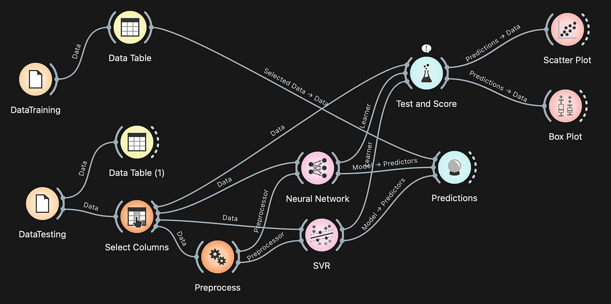

# Prediction of Student Achievement Using ANN and SVR

Orange Data Mining workflow for my master's thesis (Magister Teknik Informatika,
IIB Darmajaya), published in **JURNAL INFOTEL** Vol. 16 No. 3 (2024).

📄 Paper: https://doi.org/10.20895/infotel.v16i3.1163

## Method
- **Data:** academic and non-academic records of students at SMK Telkom Lampung
  (average score, rank, lateness, absence, academic and non-academic achievements,
  extracurricular activities, distance from home, and others)
- **Preprocessing:** feature normalization
- **Models:**
  - Artificial Neural Network (2 hidden layers: 100 and 200 neurons)
  - Support Vector Regression (SVR)
- **Evaluation:** MSE, RMSE, MAE, R²

## Files
| File | Description |
|---|---|
| `ann-svr-workflow.ows` | Orange workflow (open with Orange 3) |
| `workflow.png` | Workflow diagram |

## Data privacy
The original dataset contains students' personal information and is **not included**
in this repository.

## Citation
Susanti, D., & Triloka, J. (2024). Prediction of Student Achievement Using Artificial
Neural Network and Support Vector Regression at SMK Telkom Lampung.
*JURNAL INFOTEL*, 16(3). https://doi.org/10.20895/infotel.v16i3.1163
